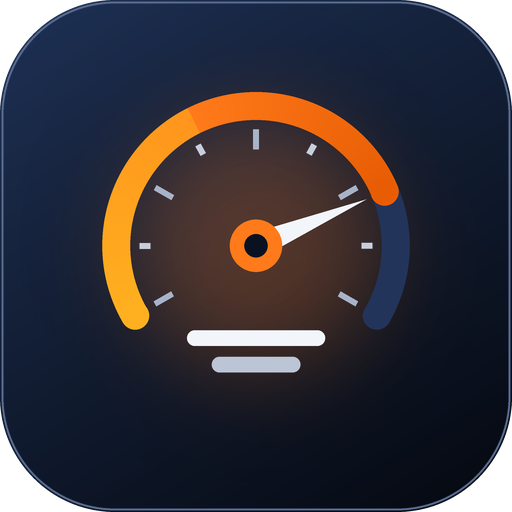

<p align="center">
  
</p>

<h1 align="center">AUTODOC</h1>
<p align="center"><b>Araç Yönetim Sistemi</b> — Windows ve Android için çevrimdışı araç, yakıt, bakım ve servis kaydı uygulaması</p>

<p align="center">
  <a href="https://github.com/furkantr1923/autodoc/actions/workflows/build.yml"></a>
  
  
  
</p>

---

## Öne çıkanlar

| | |
|---|---|
| 🚗 **Çoklu araç** | Otomobil, SUV, motosiklet, hafif ticari, kamyon, otobüs, karavan, traktör |
| ⛽ **Yakıt kayıtları** | Miktar, birim fiyat, toplam (biri girilince diğeri hesaplanır), istasyon, depo dolu |
| 🔧 **Bakım ve servis** | Tarih, kilometre ve yapılan işlem odaklı kronolojik geçmiş |
| 📏 **Kilometre doğrulama** | Negatif/gerçek dışı değer engeli, şüpheli düşüş ve kronoloji uyarısı |
| 🛡️ **Sigorta ve muayene** | Uygulama içi durum: geçerli / yaklaşıyor / süresi doldu (uyarı süresi ayarlanabilir) |
| 🔎 **Arama** | Araç, plaka, kategori ve açıklamalarda Türkçe karakter duyarsız anlık arama |
| 🔒 **Gizlilik** | İnternet, hesap, bulut, senkronizasyon yok. Her cihazın kendi yerel veritabanı |
| 🇹🇷 **Tamamen Türkçe** | Menüler, formlar, doğrulama ve hata mesajları, tarih ve para biçimleri |

## İndirme

Derlenmiş paketler GitHub Actions tarafından üretilir:

- **Actions → son başarılı çalıştırma → Artifacts**: `AUTODOC-Windows` (Setup.exe + taşınabilir ZIP), `AUTODOC-Android` (APK)
- **Releases**: `v1.0.0` gibi bir etiket gönderildiğinde paketler otomatik olarak sürüme eklenir.

Kurulum adımları: [docs/KURULUM.md](docs/KURULUM.md) · Kullanım: [docs/KULLANIM_KILAVUZU.md](docs/KULLANIM_KILAVUZU.md)

## Teknoloji

| Katman | Seçim | Neden |
|---|---|---|
| Arayüz | Flutter 3.27 (Material 3, özel koyu tema) | Windows ve Android'de yerel performans, tek ve tutarlı iş mantığı |
| Veritabanı | SQLite — Android: `sqflite`, Windows: `sqflite_common_ffi` + paketli `sqlite3.dll` | Gömülü, sunucusuz, ilişkisel; yabancı anahtar ve CHECK kısıtları |
| Durum yönetimi | `ChangeNotifier` + `InheritedNotifier` | Ek bağımlılık olmadan, öngörülebilir veri akışı |
| Yerelleştirme | `flutter_localizations`, `intl` (tr_TR) | Takvim, tarih ve para biçimleri Türkçe |
| Paketleme | GitHub Actions, Inno Setup, apksigner | Tekrarlanabilir, belgelenmiş derleme |

## Mimari

```
lib/
├── core/          tema, biçimlendiriciler, sayı/metin yardımcıları
├── data/          modeller, SQLite şeması, repository'ler, fotoğraf deposu
├── domain/        kilometre doğrulama, yasal tarih durumu, VIN çözümleme, yakıt hesabı
├── state/         AppState (tek doğruluk kaynağı: veritabanı)
├── ui/            panel, araçlar, detay, formlar, arama, ayarlar, hakkında
├── bootstrap.dart platforma göre veritabanı ve veri klasörü
└── self_test.dart derlenmiş uygulamanın kendini sınaması (CI)
```

Ayrıntılar ve veritabanı şeması: [docs/MIMARI.md](docs/MIMARI.md)

## Geliştirme

```bash
flutter pub get
dart run tool/setup.dart      # android/ ve windows/ klasörlerini üretir, AUTODOC ayarlarını uygular
flutter run -d windows        # veya: flutter run -d <android-cihaz>
flutter test                  # birim, veritabanı ve arayüz testleri
```

Platform klasörleri, kullanılan Flutter sürümünün resmi şablonundan `tool/setup.dart` ile üretilir; uygulamaya özel tüm platform ayarları bu tek dosyada tutulur.

## Testler

- **Birim testleri** — kilometre doğrulama, yasal tarih hesapları, VIN, sayı ayrıştırma, Türkçe arama
- **Veritabanı testleri** — gerçek SQLite: CRUD, kalıcılık, CASCADE silme, kısıtlar
- **Arayüz testleri** — gezinme, doğrulama mesajları, geri tuşu, telefon ekranında taşma kontrolü
- **Uçtan uca testler** — Windows'ta ve Android 14 emülatöründe gerçek uygulama akışı
- **Release kendini sınama** — derlenmiş `autodoc.exe` paketli `sqlite3.dll` ile CI'da çalıştırılır

Sonuçlar her CI çalıştırmasında `test-sonuclari`, `windows-test-sonuclari`, `android-test-sonuclari` olarak saklanır. Bkz. [docs/TEST_RAPORU.md](docs/TEST_RAPORU.md).

## Kapsam dışı (bilinçli olarak)

Bulut hesabı, senkronizasyon, otomatik yedekleme, dışa aktarma, PDF/Excel raporları, istatistik panoları, otomatik bakım önerisi, arıza tahmini ve harici bildirimler bu sürümde **yoktur**. Kilometre için şemada `mileage_source` alanı bulunur; ileride OBD-II entegrasyonu eklenebilir, ancak bu sürümde otomatik takip yapılmaz.

---

<p align="center">Furkan Baykal tarafından geliştirildi · © 2026</p>
